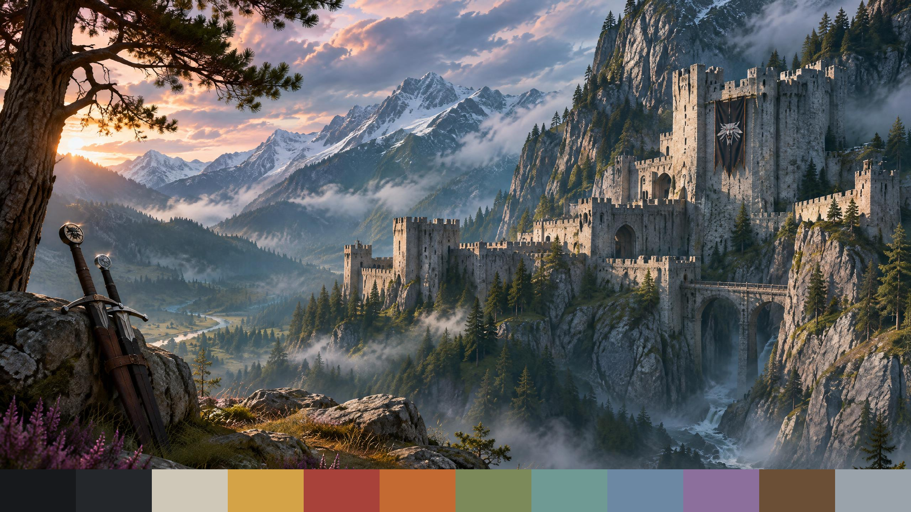

# Kaer Morhen

A moody, dark [Omarchy](https://omarchy.org) theme inspired by The Witcher: wet keep stone, parchment, cat-eye gold, and the colours of the Signs.



## Install

```bash
omarchy theme install https://github.com/cbowofrivia/omarchy-kaer-morhen-theme
```

Boot screen (asks for your password, rebuilds the initramfs; run it in a terminal):

```bash
omarchy plymouth set by theme kaer-morhen
```

## What's in it

| File | What it does |
|------|--------------|
| `colors.toml` | The palette. Omarchy generates terminal, Neovim, btop, Hyprland and other app themes from it. |
| `shell.toml` | Bar (translucent dark stone, silver text) and lock screen (gold-to-silver sword border, gold while typing). |
| `unlock.png` | Boot screen logo: crossed swords in a gold ring with "PodOS" in gold. Swap in your own 800×188 PNG to change it. |
| `preview-unlock.png` | Boot screen preview for the Plymouth switcher. |
| `icons.theme` | Yaru warty-brown dark icons. |
| `backgrounds/` | Wallpaper of a keep in the mountains (AI-generated). |

## Palette

| Role | Colour | |
|------|--------|-|
| Background | `#17191c` | keep stone at night |
| Foreground | `#cfc8b8` | bone & parchment |
| Accent / yellow | `#d4a347` | cat-eye gold, Quen |
| Red | `#a8423a` | blood on steel |
| Orange | `#c46a32` | Igni |
| Green | `#7c8a5a` | Velen moss |
| Cyan | `#6f9a94` | Axii |
| Blue | `#6c88a3` | Aard / steel |
| Magenta | `#8c6f9c` | Yrden |
| Brown | `#6b4f36` | worn leather |

Window borders run gold to silver: the two swords.

A personal fan theme, not affiliated with CD PROJEKT RED or Andrzej Sapkowski.
